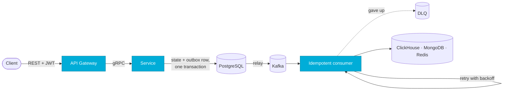
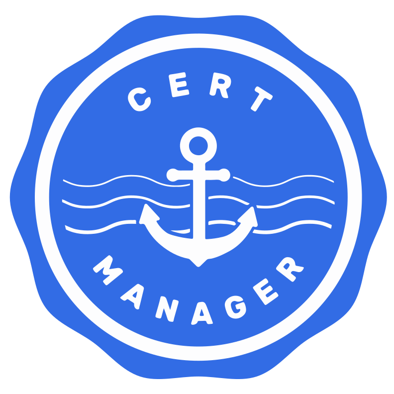
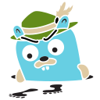

  

  
  
  

  <b>Go backend developer who cares where every event ends up.</b> 
  Intern at Innowise · 3rd year at BSUIR · Minsk · English B2

  

## 🧭 What I do

<table>
<tr>
<td width="33%" valign="top">

### 📨 Event-driven backends
Go microservices that talk over gRPC and Kafka.
Transactional Outbox, idempotent consumers, retry with backoff, DLQ.
No lost events, no duplicates.

</td>
<td width="33%" valign="top">

### ☸️ Kubernetes platform
Operators on Kubebuilder and controller-runtime, mutating and validating webhooks.
Self-service environments on Crossplane v2.

</td>
<td width="33%" valign="top">

### 🔬 Proof, not hope
Unit, integration and E2E tests.
Prometheus metrics, OpenTelemetry traces in Jaeger, load and chaos tests before I call it done.

</td>
</tr>
</table>

## 🚀 Featured work

<table>
<tr>
<td width="50%" valign="top">

#### ☸️ [jobpool-operator](https://github.com/kiryshabutor/jobpool-operator)
Keeps batch Jobs from flooding a namespace. A mutating webhook queues the extras, the controller releases them FIFO. A validating webhook with an optimistic lock lets exactly one JobPool per namespace through.

`500 Jobs → max 10 at once` · `89% coverage`

Go · Kubebuilder · controller-runtime · cert-manager · kind

</td>
<td width="50%" valign="top">

#### 🏗️ [workspace-factory](https://github.com/kiryshabutor/workspace-factory)
One YAML gives a team its environment. An XRD with CEL validation and a Pipeline Composition create namespace, ResourceQuota and Deployment in the fleet cluster. Manual edits are rolled back.

`1 YAML → full workspace` · `drift auto-healed`

Crossplane v2 · CEL · Kubernetes · kind

</td>
</tr>
<tr>
<td width="50%" valign="top">

#### 🚕 RideCore
Study taxi platform, built solo: User, Auth, Driver, Order, Wallet, Analytics and API Gateway. Events flow through Transactional Outbox and survive SIGKILL and a 30 s Kafka outage.

`7 services` · `~3 100 RPS, p99 < 70 ms` · `83% coverage`

Go · gRPC · Kafka · PostgreSQL · MongoDB · Redis · ClickHouse · OpenTelemetry

</td>
<td width="50%" valign="top">

#### ⏰ [event-driven-reminders](https://github.com/kiryshabutor/event-driven-reminders)
Delayed reminders across five services with a REST gateway, internal gRPC and access/refresh tokens. Kafka events go out through Transactional Outbox and are deduplicated by EventID in the same SQL transaction.

`5 services` · `dedup by EventID`

Go · PostgreSQL · Redis · Kafka · gRPC

</td>
</tr>
</table>

  Smaller things: <a href="https://github.com/kiryshabutor/load-balancer">load-balancer</a> (lock-free round-robin, health checks) · <a href="https://github.com/kiryshabutor/lru-cache-proxy">lru-cache-proxy</a> (thread-safe O(1) LRU)

## 🔁 How an event travels in my systems

## 🧰 Stack

<table>
<tr><td><b>Core</b></td><td align="center" width="96"> Go</td><td align="center" width="96"> gRPC · Protobuf</td><td align="center" width="96"> OpenAPI</td><td align="center" width="96"> JWT</td></tr>
<tr><td><b>Data</b></td><td align="center" width="96"> PostgreSQL</td><td align="center" width="96"> MongoDB</td><td align="center" width="96"> Redis</td><td align="center" width="96"> Elasticsearch</td><td align="center" width="96"> ClickHouse</td></tr>
<tr><td><b>Messaging</b></td><td align="center" width="96"> Kafka</td><td align="center" width="96"> RabbitMQ</td></tr>
<tr><td><b>Platform</b></td><td align="center" width="96"> Kubernetes · Kubebuilder</td><td align="center" width="96"> Crossplane</td><td align="center" width="96"> cert-manager</td><td align="center" width="96"> Docker</td><td align="center" width="96"> S3 · EKS · IAM</td></tr>
<tr><td><b>Delivery</b></td><td align="center" width="96"> GitLab CI/CD</td><td align="center" width="96"> GitHub Actions</td><td align="center" width="96"> Git</td><td align="center" width="96"> Linux</td></tr>
<tr><td><b>Observe</b></td><td align="center" width="96"> Prometheus</td><td align="center" width="96"> Grafana</td><td align="center" width="96"> OpenTelemetry</td><td align="center" width="96"> Jaeger</td></tr>
<tr><td><b>Daily tools</b></td><td align="center" width="96"> Postman</td><td align="center" width="96"> Claude Code</td><td align="center" width="96"> Cursor</td></tr>
</table>

---

  Currently: Go Backend Developer Intern @ Innowise · Looking forward to: highload

