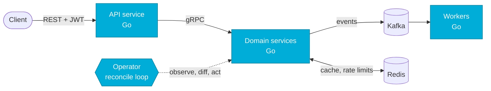

<p align="center">
  
</p>

```go
package main

import "fmt"

type Developer struct {
	Name     string
	Role     string
	School   string
	City     string
	Loves    []string
	Learning []string
}

func main() {
	me := Developer{
		Name:   "Kiryl Butar",
		Role:   "Go backend developer",
		School: "BSUIR, FKSIS",
		City:   "Minsk",
		Loves: []string{
			"concurrency", "gRPC", "Kafka", "Redis",
			"zero-allocation hot paths", "boring, reliable services",
		},
		Learning: []string{
			"Kubernetes operators", "admission webhooks", "Crossplane",
		},
	}

	for {
		fmt.Println("ship it:", me.Loves[0])
		// TODO: sleep
	}
}
```

## How I like to build things



Small services, explicit contracts, events instead of shared state. And when the platform needs to behave, I write the operator for it.

## `kubectl get projects`

| NAME | STACK | WHAT IT DOES |
|---|---|---|
| [jobpool-operator](https://github.com/kiryshabutor/jobpool-operator) | Go · controller-runtime · webhooks | Caps concurrently running Jobs per namespace; a validating webhook allows one JobPool per namespace |
| [workspace-factory](https://github.com/kiryshabutor/workspace-factory) | Crossplane v2 · kind | Self-service tenant workspaces across two clusters |
| [event-driven-reminders](https://github.com/kiryshabutor/event-driven-reminders) | Go · gRPC · Kafka · Redis · JWT | Reminders as an event-driven microservice system |
| [tcp-ingest-gateway](https://github.com/kiryshabutor/tcp-ingest-gateway) | Go · Kafka | Zero-allocation TCP gateway for binary IoT telemetry |
| [finance-tracker-bot](https://github.com/kiryshabutor/finance-tracker-bot) | Go · Telegram | Personal finance tracker: bot plus Web App |
| [load-balancer](https://github.com/kiryshabutor/load-balancer) | Go · sync/atomic | Round-robin balancer with reverse proxying |
| [lru-cache-proxy](https://github.com/kiryshabutor/lru-cache-proxy) | Go | Caching proxy with O(1) LRU eviction |
| [state-machine](https://github.com/kiryshabutor/state-machine) | Go · generics | Thread-safe FSM with lifecycle hooks |

## Toolbox

<p>
  
</p>

<p align="center">
  <sub>Currently reading: <code>kubernetes/kubernetes</code> source, one controller at a time.</sub>
</p>
