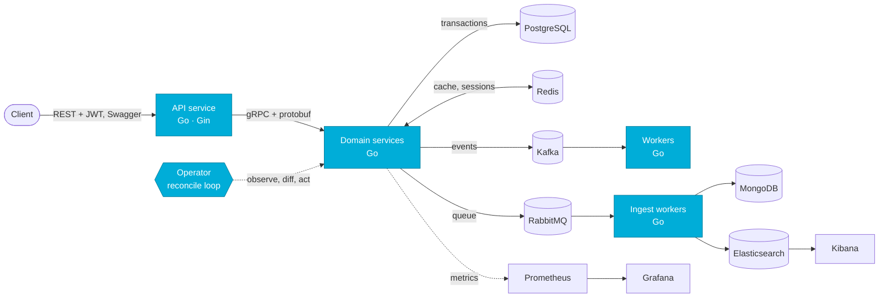

<p align="center">
  
</p>

```go
package main

import "fmt"

type Stack struct {
	Language  string
	Backend   []string
	Brokers   []string
	Databases []string
	Cloud     []string
	DevOps    []string
	Observe   []string
}

type Developer struct {
	Name   string
	Role   string
	School string
	City   string
	Stack  Stack
	Next   []string
}

func main() {
	me := Developer{
		Name:   "Kiryl Butar",
		Role:   "Go backend developer",
		School: "BSUIR, FKSIS",
		City:   "Minsk",
		Stack: Stack{
			Language:  "Go",
			Backend:   []string{"Gin", "gRPC", "protobuf", "sqlx", "Swagger", "Zap", "testify", "mockery", "gomock", "pprof"},
			Brokers:   []string{"Kafka", "RabbitMQ"},
			Databases: []string{"PostgreSQL", "Redis", "MongoDB", "Elasticsearch"},
			Cloud:     []string{"AWS (EKS, S3, Secrets Manager, CloudWatch, IAM)", "GCP (GKE, GCE, Cloud Functions)"},
			DevOps:    []string{"Kubernetes", "Docker", "Docker Compose", "GitLab CI/CD", "GitHub Actions"},
			Observe:   []string{"Prometheus", "Grafana", "ELK (Elasticsearch, Logstash, Kibana)"},
		},
		Next: []string{"Kubernetes operators", "admission webhooks", "Crossplane"},
	}

	for {
		fmt.Println("ship it:", me.Stack.Language)
		// TODO: sleep
	}
}
```

## How I like to build things



Small services, explicit contracts, events instead of shared state. And when the platform needs to behave, I write the operator for it.

## `kubectl get projects`

| NAME | STACK | WHAT IT DOES |
|---|---|---|
| [jobpool-operator](https://github.com/kiryshabutor/jobpool-operator) | Go · controller-runtime · webhooks | Caps concurrently running Jobs per namespace; a validating webhook allows one JobPool per namespace |
| [workspace-factory](https://github.com/kiryshabutor/workspace-factory) | Crossplane v2 · kind | Self-service tenant workspaces across two clusters |
| [event-driven-reminders](https://github.com/kiryshabutor/event-driven-reminders) | Go · gRPC · Kafka · Redis · JWT | Reminders as an event-driven microservice system |
| [tcp-ingest-gateway](https://github.com/kiryshabutor/tcp-ingest-gateway) | Go · Kafka | Zero-allocation TCP gateway for binary IoT telemetry |
| [finance-tracker-bot](https://github.com/kiryshabutor/finance-tracker-bot) | Go · Telegram | Personal finance tracker: bot plus Web App |
| [load-balancer](https://github.com/kiryshabutor/load-balancer) | Go · sync/atomic | Round-robin balancer with reverse proxying |
| [lru-cache-proxy](https://github.com/kiryshabutor/lru-cache-proxy) | Go | Caching proxy with O(1) LRU eviction |
| [state-machine](https://github.com/kiryshabutor/state-machine) | Go · generics | Thread-safe FSM with lifecycle hooks |

## Toolbox

**Language**


**Backend**: Gin · gRPC · protobuf · sqlx · Swagger · Zap · testify · mockery · gomock · pprof · kafka-go · redis-go · mongo-go · go-rabbitmq

**Messaging**


**Databases**


**Cloud**


`AWS`: EKS · S3 · Secrets Manager · CloudWatch · IAM &nbsp;|&nbsp; `GCP`: GKE · GCE · Load Balancing · Secret Manager · Cloud Functions

**DevOps**


Docker Compose · GitLab CI/CD · Crossplane · kind

**Observability**


Prometheus · Grafana · CloudWatch · ELK (Elasticsearch, Logstash, Kibana)

<p align="center">
  <sub>Currently reading: <code>kubernetes/kubernetes</code> source, one controller at a time.</sub>
</p>
