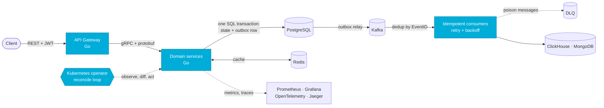

<p align="center">
  
</p>

```go
package main

import "fmt"

type Stack struct {
	Language  string
	Backend   []string
	Data      []string
	Infra     []string
	Quality   []string
}

type Developer struct {
	Name   string
	Role   string
	School string
	City   string
	Stack  Stack
	Goal   string
}

func main() {
	me := Developer{
		Name:   "Kiryl Butar",
		Role:   "Go Backend Developer Intern @ Innowise",
		School: "BSUIR, Computer Engineering, 3rd year",
		City:   "Minsk",
		Stack: Stack{
			Language: "Go",
			Backend:  []string{"REST", "gRPC", "Protobuf", "OpenAPI/Swagger", "JWT", "Microservices", "Clean Architecture"},
			Data:     []string{"PostgreSQL", "MongoDB", "Redis", "Elasticsearch", "ClickHouse", "Kafka", "RabbitMQ"},
			Infra:    []string{"Docker", "Kubernetes", "Kubebuilder", "Crossplane", "AWS S3/EKS/IAM/Secrets Manager", "GitLab CI/CD", "GitHub Actions"},
			Quality:  []string{"Testify", "GoMock", "Mockery", "Prometheus", "Grafana", "OpenTelemetry", "Jaeger"},
		},
		Goal: "highload",
	}

	for {
		fmt.Println("outbox -> kafka -> idempotent consumer, no duplicates, no losses:", me.Goal)
		// TODO: sleep
	}
}
```

## How I like to build things



Events that are never lost and never doubled: Transactional Outbox, idempotent consumers, retry with backoff, DLQ. Proven with a chaos test, not just claimed: services killed with SIGKILL, Kafka down for 30 s, 1000 of 1000 registrations accepted, 0 lost, 0 duplicates.

## `kubectl get projects`

| NAME | STACK | WHAT IT DOES |
|---|---|---|
| [jobpool-operator](https://github.com/kiryshabutor/jobpool-operator) | Go · Kubebuilder · controller-runtime · webhooks · cert-manager | Keeps batch Jobs from overloading a namespace: a mutating webhook queues the extras, the controller runs them FIFO. A validating webhook with an optimistic lock allows exactly one JobPool per namespace |
| [workspace-factory](https://github.com/kiryshabutor/workspace-factory) | Crossplane v2 · CEL · kind | One YAML creates a tenant workspace in the fleet cluster: namespace, ResourceQuota, Deployment. Manual drift is rolled back |
| RideCore | Go · gRPC · Kafka · PostgreSQL · MongoDB · Redis · ClickHouse · OpenTelemetry | Study taxi platform: 7 microservices, 83% test coverage, about 3 100 RPS at p99 under 70 ms through the gateway |
| [event-driven-reminders](https://github.com/kiryshabutor/event-driven-reminders) | Go · PostgreSQL · Redis · Kafka · gRPC | Delayed reminders across 5 services with Transactional Outbox and dedup by EventID |
| [load-balancer](https://github.com/kiryshabutor/load-balancer) | Go · sync/atomic | HTTP balancer with lock-free round-robin and health checks |
| [lru-cache-proxy](https://github.com/kiryshabutor/lru-cache-proxy) | Go | HTTP proxy with a thread-safe LRU cache, O(1) |

## Toolbox

**Language**


**Data and messaging**


ClickHouse

**Infrastructure**


Kubebuilder · Crossplane · AWS (S3, CloudFront, EKS, IAM, Secrets Manager)

**Testing and monitoring**


Testify · GoMock · Mockery · OpenTelemetry · Jaeger

**Tools**


Claude Code · Codex · Cursor

---

<p align="center">
  <sub>Telegram: <a href="https://t.me/kiryldev">@kiryldev</a> · English B2 · open to highload backend roles</sub>
</p>
